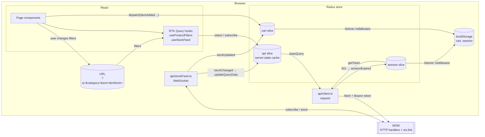

# Architecture

The Bug Bazaar is a single-page React 19 + TypeScript app. Redux Toolkit holds client state, RTK
Query caches server state, and the URL holds view state. All network traffic goes through one HTTP
client. In development and in the deployed demo, a Mock Service Worker plays the backend.

## Folder structure

```
src/
├── main.tsx              Starts the mock API (if enabled), installs global error handlers, renders <App>
├── app/                  Wiring that knows about every feature
│   ├── App.tsx           Creates the store and router once
│   ├── routes.tsx        Route table; protected routes are wrapped in <RequireAuth>
│   ├── Layout.tsx        Header, skip link, page error boundary, focus management, Mock controls
│   ├── store.ts          configureStore: api + cart + session reducers, listener + logging middleware
│   ├── persistence.ts    Load/save cart and session to localStorage, with validation
│   ├── apiErrorLogger.ts Middleware that logs 5xx and network API failures
│   └── hooks.ts          Typed useAppDispatch / useAppSelector / useAppStore
├── api/                  The data layer: the only code that talks to the network
│   ├── client.ts         request(): base URL, JSON, token, error normalization, 401 hook
│   ├── baseApi.ts        RTK Query createApi with a baseQuery adapter over request()
│   ├── errors.ts         AppError union, fromHttpResponse(), describeError() (all error copy)
│   ├── stockFeed.ts      WebSocket client with reconnect/backoff (the only WebSocket in src/)
│   └── types.ts          Shared API contract types (also used by the mocks)
├── features/             One folder per feature: its endpoints, state, hooks and screens
│   ├── products/         List (filters, virtual grid), details, live stock, filter URL sync
│   ├── cart/             cartSlice (lines, derived count/total, checkout key), cart UI
│   ├── auth/             sessionSlice, login/me endpoints, LoginPage, RequireAuth, AccountPage
│   ├── orders/           createOrder/getOrder endpoints, CheckoutPage, OrderPage (polling)
│   └── devtools/         Mock controls panel (lazy-loaded), crash trigger
├── components/           Shared presentational pieces: AsyncView, status views, Price, ErrorBoundary…
├── hooks/                Generic reusable hooks: useDebouncedValue, useEventListener, useDocumentTitle
├── lib/                  Framework-free helpers: money, logger, RequestState and its adapter
├── mocks/                The fake backend: seed, db, HTTP handlers, WebSocket server, chaos settings
└── test/                 Vitest setup and renderApp() (the whole app at a URL)
```

**Dependency direction:** `app → features → (components, hooks, lib, api)`. Features import only
two leaf modules from `app/`: the typed hooks in `app/hooks.ts` (its import of the store is
type-only, so it's erased at build time and creates no runtime cycle) and `NotFoundPage`. `api/`
imports nothing from features. The store hands the HTTP client a `getToken` / `onUnauthorized`
pair, so the client never imports the store. oxlint's `import/no-cycle` rule fails the build on
any cycle.

## Data flow



**One request, end to end (search for "duck"):**

1. The user types. `FilterBar` holds the text locally, and `useDebouncedValue` waits 300 ms.
2. `useProductFilters` writes `?q=duck` to the URL (replace, not push, while refining).
3. `ProductListPage` re-renders with the filters parsed from the URL and calls
   `useGetProductsInfiniteQuery(filters)`.
4. RTK Query checks the cache for those exact args. On a miss, it calls the `baseQuery` adapter,
   which calls `request('/api/products', { params })`.
5. `request()` builds the URL, attaches the token, calls `fetch`, and either returns the JSON or
   throws a `RequestError` carrying a typed `AppError`.
6. MSW answers from `mocks/db.ts`. The result is cached under `{search:'duck', …}`.
7. The page reads `currentData` (only data for the _current_ args) through `toRequestState()` and
   renders it with `<AsyncView>` → `<VirtualProductGrid>`.
8. The grid reports which product ids are on screen, and `useStockFeed` subscribes to just those.
   Stock pushes patch the cache entry in place.

## Where each kind of state lives

| Kind of state                                     | Lives in                                                 | Examples                                                                                         | Why there                                                                                                                      |
| ------------------------------------------------- | -------------------------------------------------------- | ------------------------------------------------------------------------------------------------ | ------------------------------------------------------------------------------------------------------------------------------ |
| **Server state** (a copy of data the server owns) | RTK Query cache (`api` slice)                            | products, product pages, `/me`, orders                                                           | Needs caching, de-duplication, invalidation, polling and live patching. RTK Query does all of that, keyed by request args.     |
| **Client state** (owned by this browser)          | Redux slices `cart` and `session`, saved to localStorage | cart lines, checkout idempotency key, token + user                                               | Shared across many screens (the header badge, cart and checkout), must survive reload, and changes only through named actions. |
| **URL state** (what the user is looking at)       | The address bar                                          | search, category, sort, in-stock; `/products/:id`; `/orders/:id`                                 | Refresh, shareable links and Back/Forward come for free. There is no second copy to keep in sync.                              |
| **Local UI state**                                | `useState` in the component                              | the search box while typing, quantity input, login form values and errors, "Added to cart" flash | Nobody else needs it, and it should vanish when the component unmounts.                                                        |
| **Mock "server" state**                           | `mocks/db.ts`, saved to localStorage                     | stock levels, orders, sessions, idempotency keys                                                 | Stands in for a database, so a reload behaves like a real server that remembers.                                               |

### The choice I'd defend: filters live only in the URL

The filters are never in Redux or `useState`. `useProductFilters()` parses them from
`useSearchParams()` on every render and writes changes back with `setSearchParams`.

- **What it buys:** refresh, a copied link and the Back button all reproduce the view, with no
  sync code. The parsed filter object is the RTK Query cache key, so Back to a previous search
  renders from the cache instantly.
- **The cost:** every value from the URL is untrusted, so parsing validates each one
  (`isCategory`, `isSortOption`) and falls back to defaults. The search box needs a small local
  buffer and debounce, so the URL (and history) isn't updated on every keystroke.
- **The alternative and why not:** a Redux `filters` slice synced to the URL with effects gives two
  sources of truth. The classic bug is pressing Back: the URL changes but the slice doesn't, or an
  effect fires in the wrong order and pushes the old filters back. With one source, that bug can't
  exist.

## Design patterns used

### 1. Adapter: `baseQuery` over `request()`, and `toRequestState()`

- **Where:** `src/api/baseApi.ts` (RTK Query's `BaseQueryFn` → our `request()`),
  `src/api/errors.ts` (`fromHttpResponse`: HTTP status + body → `AppError`),
  `src/lib/queryState.ts` (RTK Query's many flags → one `RequestState` union).
- **Why:** each adapter translates a third-party or wire format into our own types at the
  boundary. RTK Query never calls `fetch` itself, so token handling, 401 logic and error
  normalization exist once. Components never see HTTP statuses or RTK flags, only `AppError` and
  `RequestState`, so swapping the backend or the data library touches one file.

### 2. Container and presentational components

- **Where:** containers fetch and decide: `ProductListPage`, `ProductDetailsPage`, `CheckoutPage`,
  `AccountPage`. Presentational components only render props: `ProductCard`, `Price`, `Rating`,
  `StockBadge`, `EmptyState`, `ErrorState`, `CartSummary` (which reads selectors but holds no
  logic), and `AsyncView`.
- **Why:** presentational components are reused across pages (the same `ProductCard` in the list
  and in "Top rated" on the details page; the same `ErrorState` everywhere) and are trivial to
  memoize. `ProductCard`'s props are plain data, which is why `React.memo` works so well there.
  Containers are where the tests point.

### 3. Custom hooks (logic without UI)

- **Where:** generic: `useDebouncedValue`, `useEventListener`, `useDocumentTitle`. Feature:
  `useProductFilters` (URL ↔ filters), `useProductDetails` (subscribe + abort on switch),
  `useStockFeed` (WebSocket lifecycle).
- **Why:** each owns one side effect and its cleanup, so components stay declarative, and the
  tricky parts (a cleanup that must run, a timer that must be cleared) are written and tested
  once. For example, `useEventListener` is used by Back to Top and by the stock feed's
  `online`/`pagehide` handling.

Also present: **Observer/pub-sub** (the stock WebSocket, Redux listener middleware for
persistence, the tiny `mockControlEvents` bus), and a **discriminated union as a state machine**
(`RequestState`, `SessionState`, `AppError`).

## Cross-cutting concerns

| Concern     | Where                                                                                                          |
| ----------- | -------------------------------------------------------------------------------------------------------------- |
| Errors      | `api/errors.ts` → `AsyncView` / page alerts. A 401 goes through `client.ts` → `sessionExpired` → `RequireAuth` |
| Crashes     | `ErrorBoundary` (page, route, root) + `lib/logger.ts` ([monitoring.md](monitoring.md))                         |
| Auth        | [auth.md](auth.md)                                                                                             |
| Orders      | [orders.md](orders.md) (idempotency, queue design)                                                             |
| Performance | [performance.md](performance.md)                                                                               |
| Decisions   | [decisions.md](decisions.md), one entry per task                                                               |
